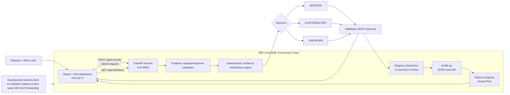

# TruthLatch — Solution Architecture

**CoreShift | IBM Z Datathon 2026 | AI Secured — Innovation Without Exposure**

## Architecture diagram

## Components and responsibilities

| Component | Responsibility |
|---|---|
| React + Vite | Form input, dashboard counters, latest decision, outcome filters and history table |
| FastAPI | HTTP endpoints: `POST /api/v1/verify`, `GET /api/v1/history`, and `GET /health` |
| Pydantic schemas | Validate fields and reject unexpected request properties |
| Verification engine | Deterministic freshness, authority, relevance and contradiction checks |
| Registry | Stores each validated verification result; demonstrated run uses an in-memory registry |
| AuditLog | Appends validated decisions to a JSON Lines file and supplies history |
| Automated tests | Exercise API behaviour, schema contracts, evidence decisions, timestamps and audit/registry behaviour |

## Decision model

- **VERIFIED:** fresh authoritative evidence supports the expected observation.
- **CONTRADICTED:** fresh authoritative evidence supports a declared contradictory observation.
- **UNKNOWN:** no sufficient eligible evidence exists, or eligible evidence conflicts.

The backend filters evidence whose required fields or types are invalid, whose authority flag is false, whose timestamp is timezone-naive/invalid/in the future, whose age exceeds the configured maximum, or whose observation is neither the expected claim nor a declared contradiction.

## IBM Z / LinuxONE use

The demonstrated prototype runs on IBM LinuxONE Community Cloud using Ubuntu on the s390x architecture. FastAPI and the React/Vite interface run on the platform; the development ports are loopback-bound and accessed from a laptop through an SSH tunnel.

This demonstrates deployment of the verification service on IBM LinuxONE. The current submission does **not** claim integration with Secure Execution, Hyper Protect Crypto Services, confidential containers, specialized hardware security modules, live AI agents, or validated live Firestore storage.

## Data and security boundaries

The submitted demo uses an in-memory registry and local JSON Lines audit log. The in-memory registry is not durable across backend restarts. The audit log is a local application log, not a cryptographically tamper-proof ledger. Evidence observations are entered through the UI, and marking them authoritative does not authenticate an external system. A production deployment would need authenticated evidence adapters, access control, secure secrets handling, durable storage, and appropriate deployment hardening.
