# TruthLatch — End-to-End Solution Flowchart

**Project:** CoreShift — TruthLatch  
**IBM Z Datathon 2026 | Theme: AI Secured — Innovation Without Exposure**

This flowchart documents the current repository implementation. It distinguishes the verified prototype path from optional/unvalidated integrations.

```mermaid
flowchart TD
    A([Start]) --> B["User/operator enters expected observation, evidence observations, source, age limit, authority flag and declared contradictions"]
    B --> C["React + Vite UI sends JSON"]
    C --> D["POST /api/v1/verify"]
    D --> E["FastAPI + Pydantic validate request schema and fields"]
    E --> F{Request valid?}
    F -- No --> X["HTTP 422 validation error"]
    F -- Yes --> G["Verifier checks non-empty claim, non-negative age limit and contradiction declaration"]
    G --> H["Evaluate evidence item by item"]
    H --> I["Require evidence ID, source, observation, timestamp and boolean authority flag"]
    I --> J["Keep only authoritative, timezone-aware, not-future, fresh evidence matching the claim or a declared contradiction"]
    J --> K["Collect distinct eligible observations"]
    K --> L{More than one distinct eligible state?}
    L -- Yes --> U1["UNKNOWN: eligible evidence conflicts"]
    L -- No --> M{Expected observation supported?}
    M -- Yes --> V["VERIFIED"]
    M -- No --> N{Declared contradictory observation supported?}
    N -- Yes --> C1["CONTRADICTED"]
    N -- No --> U2["UNKNOWN: no sufficient fresh authoritative evidence"]
    V --> R["Build response: verification ID, status, explanation, accepted evidence and checked timestamp"]
    C1 --> R
    U1 --> R
    U2 --> R
    R --> S{Registry and audit writes succeed?}
    S -- No --> Y["HTTP 500 storage/audit error"]
    S -- Yes --> T["Return verification JSON to React"]
    T --> W["Update latest result, outcome counters and success rate"]
    P["Application opens"] --> Q["GET /api/v1/history"]
    Q --> R2["Read and validate JSONL audit log; return newest first"]
    R2 --> HUI["Verification History: outcome filters and decision table"]
    W -. current in-session records .-> HUI

    subgraph STORE["Storage in demonstrated LinuxONE run"]
      MEM["In-memory registry: verification lookup/store; resets on backend restart"]
      AUD["Local JSON Lines audit log: configured by TRUTHLATCH_AUDIT_PATH"]
      MEM --> AUD
    end
    S -. successful write path .-> MEM
    AUD -. history source .-> R2

    NOTE["Scope: LinuxONE Community Cloud hosts FastAPI and React/Vite. The authority flag is user-supplied and does not authenticate the source. Live AI-agent integration, live Firestore persistence and specialized IBM security hardware features are not demonstrated."]
    HUI -.-> NOTE

    classDef good fill:#ddf6ee,stroke:#38a889,color:#145f4a;
    classDef bad fill:#ffe9e7,stroke:#d97870,color:#8c302a;
    classDef uncertain fill:#fff2d8,stroke:#d6a640,color:#76530f;
    classDef service fill:#e9f1ff,stroke:#7b9ddb,color:#142631;
    classDef storage fill:#f2f0fa,stroke:#988bc9,color:#3d3561;
    class A,V,W,HUI good;
    class C,D,E,R,T,Q,R2 service;
    class C1,X,Y bad;
    class U1,U2,F,L,M,N,S uncertain;
    class MEM,AUD storage;
```

## Outcome rules

- **VERIFIED:** at least one fresh, authoritative eligible observation equals the expected observation and there is no conflicting eligible state.
- **CONTRADICTED:** fresh, authoritative eligible evidence supports an observation explicitly listed as contradictory, without conflict.
- **UNKNOWN:** evidence is missing, invalid, irrelevant, stale, future-dated, non-authoritative or conflicting.
- **HTTP 422:** request/schema or verifier input is invalid.
- **HTTP 500:** a registry or audit write fails.

## Current implementation boundaries

The form accepts evidence entered by the user. Its “authoritative” checkbox is a demonstration flag, not source authentication. The demonstrated LinuxONE run uses `TRUTHLATCH_REGISTRY=memory` and a local JSON Lines audit file. Live Firestore persistence and direct AI-agent integrations are not yet demonstrated.
